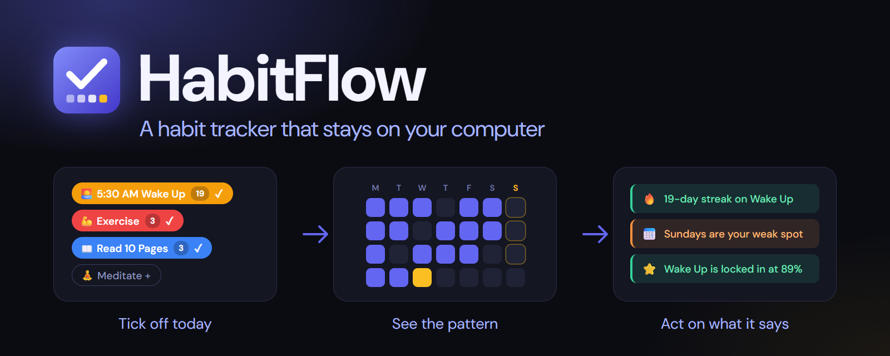
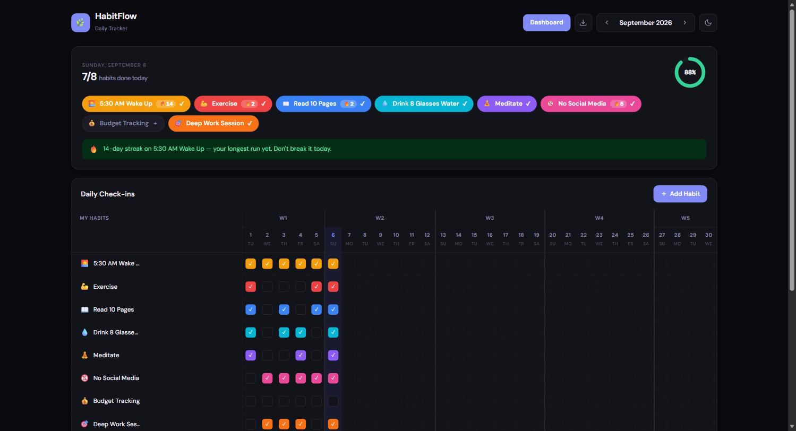
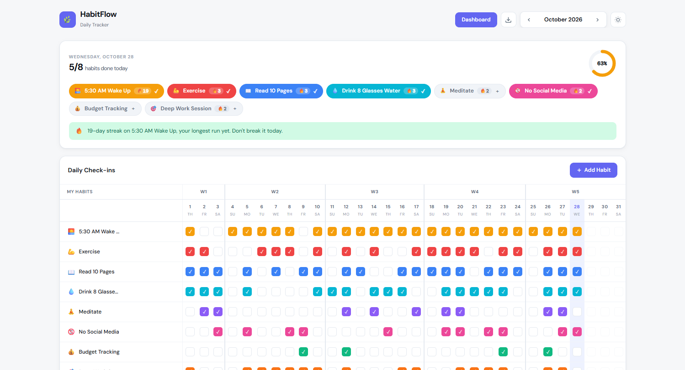
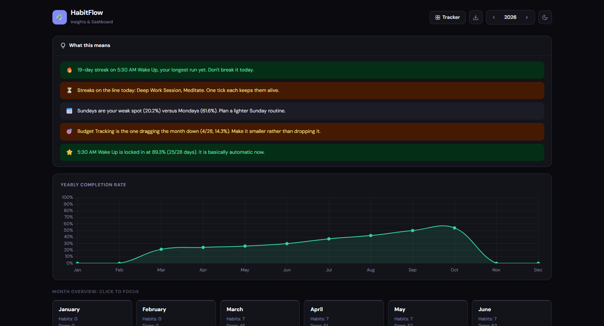
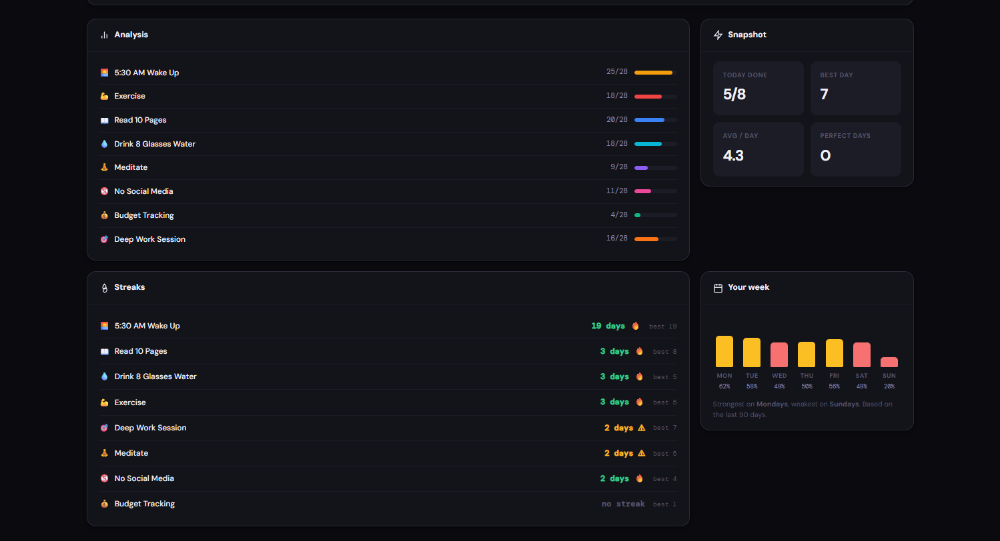
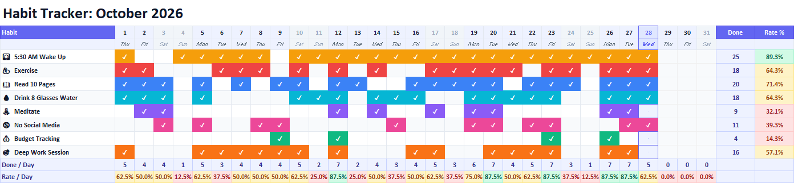
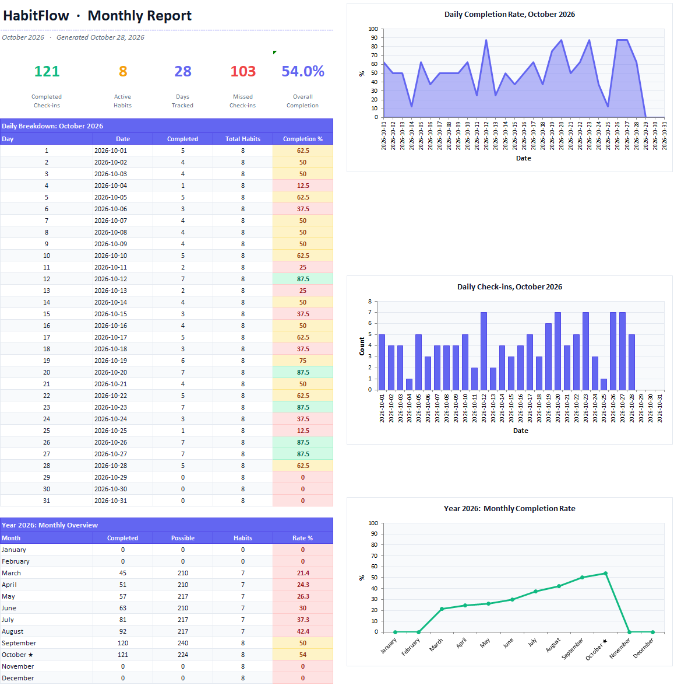
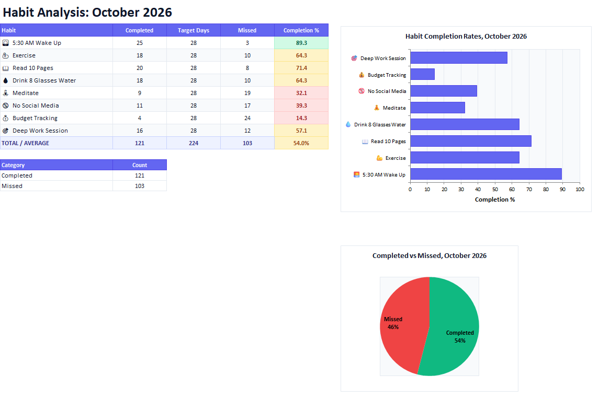
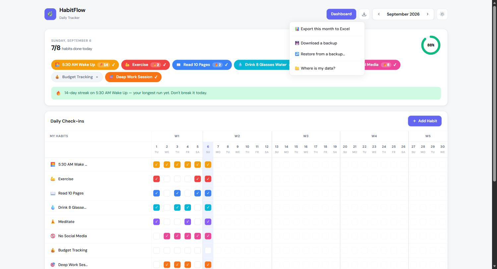
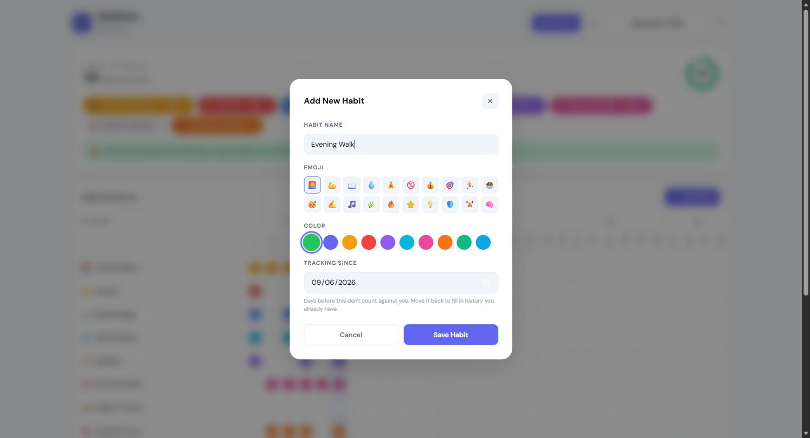

<p align="center">
  
</p>

# HabitFlow

[](https://github.com/inboxpraveen/Daily-Tracker/releases/latest)
[](https://github.com/inboxpraveen/Daily-Tracker/releases)
[](LICENSE)
[](requirements.txt)
[](https://github.com/sponsors/inboxpraveen)

HabitFlow is a free, open-source habit tracker that runs on your own computer. Tick off what you did today and it tells you what that adds up to: streaks, the day of the week you keep slipping on, the one habit dragging your month down.

No account. No subscription. No cloud. Your history lives in a single SQLite file on your machine, and the app never talks to anything except your own browser on `127.0.0.1`.

[Install](#install-windows) · [What you get](#what-you-get) · [Your data](#your-data) · [Privacy](#privacy-and-security) · [Script it](#script-it) · [Run from source](#running-from-source) · [How it works](#how-it-works) · [Sponsor](#support-the-project)

---

## Install (Windows)

1. Go to [**Releases**](../../releases/latest) and download **`HabitFlow-Setup-x.y.z.exe`**.
2. Double-click it. No admin rights needed, it installs just for you.
3. HabitFlow opens in your browser. Start ticking boxes.

After that, launch it from the Start Menu like any other app. Closing the browser tab shuts the app down on its own.

> **"Windows protected your PC"**: the installer is not code-signed, because a certificate costs money and this project has none to spend on one yet. Click **More info, then Run anyway**. Every release is built in the open on GitHub Actions; you can read the build log in the [Actions tab](../../actions) and reproduce it yourself from source.

Prefer no installer? The same release has a **portable `.zip`**. Unpack it anywhere (a USB stick works) and run `HabitFlow.exe` from the folder.

**Not on Windows?** Run it from source, see [Running from source](#running-from-source). It works on macOS and Linux; only the packaged installer is Windows-only for now.

---

## What you get

### Today
The screen you actually use daily. Every habit is a tappable chip with its current streak, a ring shows how much of today is done, and one line says what matters right now, for example *"Streaks on the line today: Exercise. One tick each keeps them alive."*



### The monthly grid
Every habit by every day, right under Today. Click any cell to fill in a day you forgot. Days before you started a habit are greyed out, so a habit you added yesterday does not make last week look like a failure.



### Insights, not just charts
The dashboard leads with **What this means**: plain sentences derived from your own data.

- *19-day streak on 5:30 AM Wake Up, your longest run yet. Don't break it today.*
- *Sundays are your weak spot (20.2%) versus Mondays (61.6%). Plan a lighter Sunday routine.*
- *Budget Tracking is the one dragging the month down (4/28, 14.3%). Make it smaller rather than dropping it.*
- *5:30 AM Wake Up is locked in at 89.3% (25/28 days). It is basically automatic now.*



Below that: how each habit did this month, current and best streak per habit, and a weekday rhythm chart over the last 90 days.



### Excel export
A formatted, multi-sheet workbook for any month: an overview with charts, the full habit grid, and a per-habit analysis sheet. Good for sharing, printing, or doing your own analysis.

<p align="center">
  
</p>
<p align="center">
  
  
</p>

### Backup and restore
The download menu in the header saves everything as one JSON file, and restores from one. Use it to move to a new computer, or before you experiment.



### Habits on your terms
Name, emoji, colour, and a **Tracking since** date, so you decide which days a habit is judged on.



---

## Your data

Everything lives in one SQLite file (plus small `-wal` and `-shm` files SQLite keeps beside it):

| System | Location |
| --- | --- |
| Windows | `%APPDATA%\HabitFlow\habits.db` |
| macOS and Linux | `~/.local/share/HabitFlow/habits.db` |

On Windows, press `Win + R`, paste `%APPDATA%\HabitFlow`, press Enter to open the folder. The app's download menu also has a **Where is my data?** entry that shows the exact path.

- **Updating keeps your history.** Installing a new version over the old one leaves the database alone.
- **Uninstalling asks first** before deleting your history.
- **Starting fresh:** delete `habits.db` and relaunch. You get a clean database with the example habits back.
- **Something went wrong?** Errors are written to `habitflow.log` in the same folder.

---

## Privacy and security

- **Nothing leaves your machine.** There is no account, no analytics and no update check. The fonts and the chart library ship inside the app, so no page loads anything from another website, and a test fails if one ever does.
- **Local only.** The server listens on `127.0.0.1` and refuses any request addressed to another hostname, which closes the DNS-rebinding route a hostile web page could otherwise use.
- **Your data stays yours.** It is one open-format SQLite file and a plain JSON backup. You can read it with any SQLite tool.

HabitFlow has no login because it is a single-user app on your own machine. If you run it somewhere other people can reach, put your own authentication in front of it. More in [SECURITY.md](SECURITY.md).

---

## How percentages are calculated

Worth knowing, because most trackers get this wrong and quietly demoralise you:

- A habit only counts on days it was actually being tracked, from the day you created it to the day you stopped. **Adding a habit today does not retroactively ruin last month**, and removing one does not rewrite your history.
- You can move a habit's start date back (**Edit habit, then Tracking since**) if you want to fill in history you already have on paper.
- A *perfect day* means everything you were tracking **that day** got done.
- The current month is scored against days that have actually happened, not the whole month.
- A streak survives today being unfinished, because the day isn't over. It shows as *at risk* instead.

---

## Script it

Everything the app does goes through a small JSON API on `127.0.0.1`, so HabitFlow also works as a building block: tick a habit from a git hook or a cron job, pull a month of numbers into your own spreadsheet, or move your history between machines with the backup file.

```bash
# add a habit
curl -X POST http://127.0.0.1:8050/api/habits \
  -H "Content-Type: application/json" -d '{"name": "Evening Walk", "emoji": "🚶"}'

# tick it for a day (this toggles: calling it again unticks)
curl -X POST http://127.0.0.1:8050/api/completions/toggle \
  -H "Content-Type: application/json" -d '{"habit_id": 9, "date": "2026-10-28"}'

# this month's numbers, and the same plain-language insights the dashboard shows
curl http://127.0.0.1:8050/api/stats/2026/10
curl http://127.0.0.1:8050/api/insights/2026/10

# a full backup
curl -OJ http://127.0.0.1:8050/api/backup
```

The app uses port 8050 when it is free and falls back to 11050, 12050, then 13050. The full list of endpoints and their responses is in [docs/API.md](docs/API.md).

---

## Running from source

```bash
git clone https://github.com/inboxpraveen/Daily-Tracker.git
cd Daily-Tracker
python -m venv .venv && . .venv/bin/activate     # Windows: .venv\Scripts\activate
pip install -r requirements.txt
python app.py
```

The terminal prints the URL. Requires Python 3.9 or newer. Conda works the same way: create an environment with Python 3.9+ and run the two commands that follow the clone.

Useful environment variables:

| Variable | Effect |
| --- | --- |
| `HABITFLOW_DATA_DIR` | Store the database somewhere else (handy for testing) |
| `HABITFLOW_NO_BROWSER=1` | Don't open a browser on start |
| `HABITFLOW_DEBUG=1` | Run Flask's debugger and auto-reloader, for development only |

If HabitFlow is already running on one of the ports, launching again just opens that window instead of starting a second copy.

### Tests

```bash
pip install -r requirements-dev.txt
python -m pytest tests -q
```

Tests run against a temporary database, so your real history is never touched.

### Building the installer yourself

```bash
pip install -r requirements-dev.txt
python packaging/make_icon.py         # assets/habitflow.ico
python packaging/make_version.py      # exe version resource
pyinstaller --noconfirm packaging/habitflow.spec
iscc /DAppVersion=1.1.0 packaging\habitflow.iss
# produces dist/HabitFlow-Setup-1.1.0.exe
```

[Inno Setup 6](https://jrsoftware.org/isdl.php) is needed for the last step (`winget install JRSoftware.InnoSetup`).

### Cutting a release

```bash
git tag v1.1.0
git push origin v1.1.0
```

GitHub Actions runs the tests, builds the app, smoke-tests the built exe, compiles the installer and attaches both the setup exe and the portable zip to a new Release.

---

## How it works

<p align="center">
  
</p>

One Python process serves two pages and a JSON API from `127.0.0.1`, and keeps all state in one SQLite file. The browser does the drawing; the server does the counting. [docs/ARCHITECTURE.md](docs/ARCHITECTURE.md) covers the data model, the rules behind the percentages and streaks, the security model and the release pipeline.

## Project layout

```text
Daily-Tracker/
├── app.py                     # Server, database, JSON API, insights
├── requirements.txt           # Runtime dependencies
├── requirements-dev.txt       # + tests and build tooling
├── templates/
│   ├── index.html             # Today + the monthly grid
│   └── dashboard.html         # Insights, streaks, trends
├── static/
│   ├── favicon.svg
│   └── vendor/                # Chart.js and the fonts, bundled so it works offline
├── packaging/
│   ├── habitflow.spec         # PyInstaller (one-folder)
│   ├── habitflow.iss          # Inno Setup installer
│   ├── make_icon.py           # generates assets/habitflow.ico
│   └── make_version.py        # generates the exe version resource
├── tests/test_app.py
├── docs/                      # ARCHITECTURE.md, API.md
└── assets/                    # logo, banner, screenshots, diagrams
```

---

## Why this exists

The idea is to help people stay consistent without paying a subscription to look at their own data. A similar app was doing the rounds on Instagram behind a paywall; this is a free, open alternative with the same goal (track daily habits, feel good about consistency) that you can read, run and change yourself.

## Support the project

HabitFlow is free and stays free. If it saved you a subscription, you can [sponsor the work on GitHub](https://github.com/sponsors/inboxpraveen). Sponsorship pays for maintenance time, and a code-signing certificate, which is what removes the Windows SmartScreen warning, is the first thing it could buy. Starring the repo and telling a friend helps too.

## Contributing

Issues and pull requests are welcome. See [CONTRIBUTING.md](CONTRIBUTING.md) for the setup and what a good pull request looks like. Security problems go through [SECURITY.md](SECURITY.md), not a public issue.

## License

Apache License 2.0. See [`LICENSE`](LICENSE). The bundled DM Sans and DM Mono fonts are under the SIL Open Font License 1.1 (the texts are in `static/vendor/fonts/`), and Chart.js is MIT (see the banner in `static/vendor/chart.umd.min.js`).
