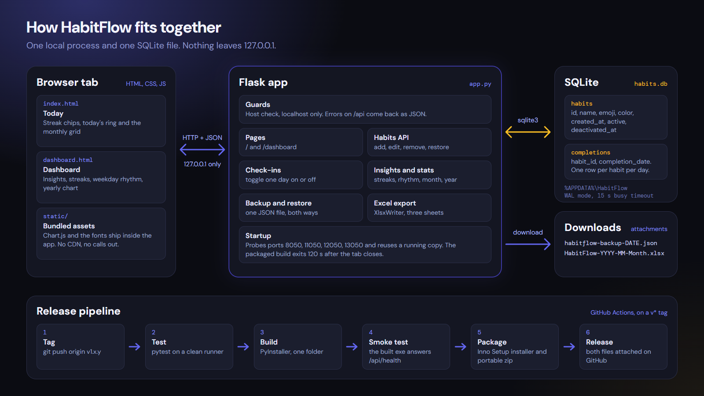
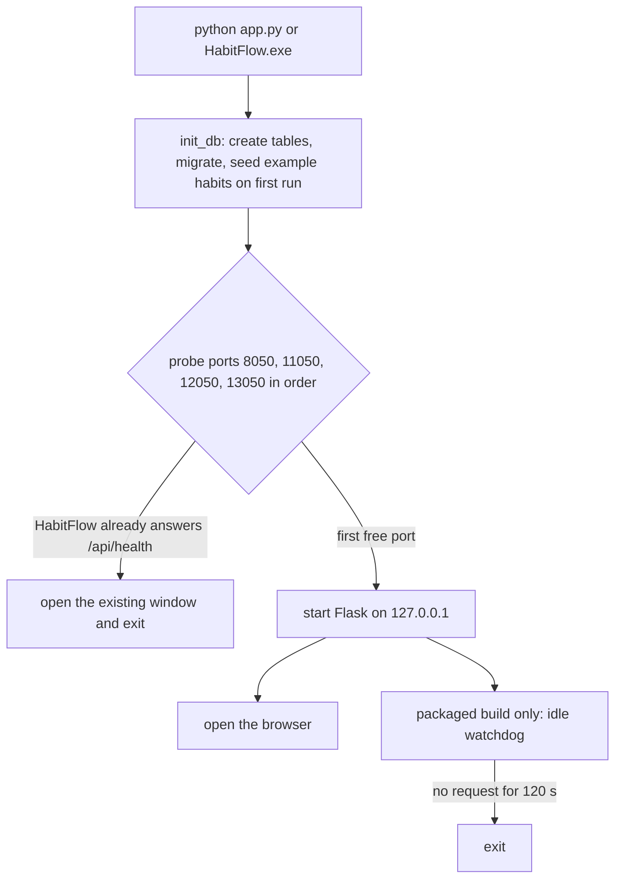
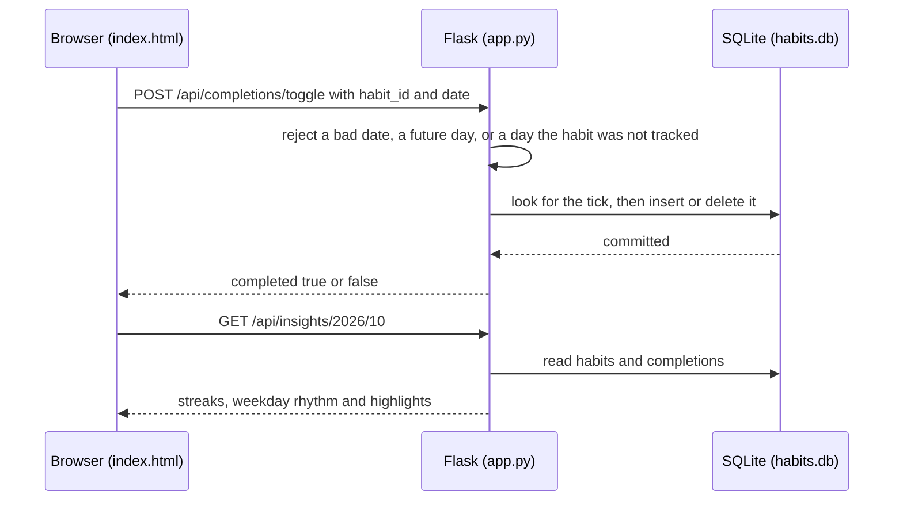
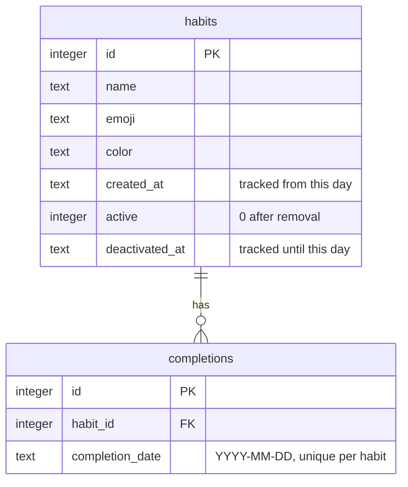

# Architecture

HabitFlow is one Python process that serves two HTML pages and a JSON API from `127.0.0.1`, and keeps all of its state in one SQLite file. The browser draws; the server counts.

  

## The pieces

| Piece | File | What it does |
| --- | --- | --- |
| Server | `app.py` | Flask app: startup, the JSON API, the percentage and streak rules, backup and restore, the Excel export |
| Today page | `templates/index.html` | Today's chips and ring, the monthly grid, the data menu, the add and edit habit dialog |
| Dashboard | `templates/dashboard.html` | Insights, per-habit analysis, streaks, weekday rhythm, the yearly chart |
| Static assets | `static/` | Favicon, Chart.js, DM Sans and DM Mono. Bundled, so nothing loads from a CDN |
| Database | `habits.db` | SQLite in WAL mode, created on first run |
| Packaging | `packaging/` | PyInstaller spec, Inno Setup script, icon and version-resource generators |
| Release | `.github/workflows/release.yml` | Builds, tests and publishes on a `v*` tag |

There is no ORM, no front-end framework and no build step for the UI. The templates are plain HTML, CSS and JavaScript, and `app.py` talks to `sqlite3` directly. That keeps the whole thing readable in an afternoon and keeps the packaged app small.

## Startup and lifecycle

- **One copy at a time.** A second launch finds the running copy through `/api/health` and just opens its window.
- **Closing the tab closes the app.** Each page sends `POST /api/heartbeat` every 10 seconds. The packaged build exits when no request of any kind has arrived for 120 seconds. Running from source has no watchdog, so `python app.py` keeps running until you stop it.
- **Debug is opt-in.** Flask's debugger and reloader only start when `HABITFLOW_DEBUG=1`, because the debugger is a code-execution console.
- **Failures leave a trail.** A fatal startup error is appended to `habitflow.log` next to the database, and the packaged exe also shows a message box, since it has no terminal.

## A request, end to end

Every API call opens its own short-lived SQLite connection with `journal_mode=WAL`, `busy_timeout=15000` and `foreign_keys=ON`. Errors on any `/api/` path come back as `{"error": "..."}` with the right status code, never as an HTML page. Pages keep Flask's normal behaviour, so a stray request for `/favicon.ico` is an ordinary 404.

## Data model

Two details carry most of the design:

- **A habit has a tracking window.** `created_at` is the first day it counts and `deactivated_at` is the last. Removing a habit is a soft delete: it sets `active = 0` and stamps `deactivated_at`, and the completions stay. Without the second date, deleting a habit would quietly change every past month's completion rate.
- **Migrations are idempotent.** `init_db()` adds `deactivated_at` to databases from older versions and backfills it from the habit's last tick, and fills any empty `created_at` from its first tick. Opening an old database with a new version is safe.

## The rules behind the numbers

The tracker, the dashboard and the Excel export all call the same helpers in `app.py`, so they cannot disagree.

- `_habit_window` and `_counts_on` decide whether a habit counts on a given day. A tick on a day before `created_at` or after `deactivated_at` is refused.
- `_habit_goal` is the number of days a habit could have been done inside a range. Percentages are `actual / goal`, so they never exceed 100.
- `_elapsed_end` scores the current month only up to today. Future days are neither done nor missed.
- A tick for a day that has not happened yet is rejected by the toggle endpoint.

### Streaks and insights

`GET /api/insights/<year>/<month>` builds everything the dashboard's **What this means** card shows.

- **Streaks.** `_streaks` walks back from today. Today being unfinished does not break a streak, because the day is not over; the habit is flagged `at_risk` instead.
- **Weekday rhythm.** `_weekday_rhythm` scores each day of the week over the last 90 days (`STREAK_WINDOW_DAYS`) and names the strongest and weakest.
- **Highlights.** Short sentences chosen by fixed rules, in this order: the longest current streak (at least 2 days), then either streaks at risk, a perfect day, or what is still open today; a weekday spread of 15 points or more; month-over-month movement of 5 points or more; a habit under 50% with at least 3 tracked days; a habit at 80% or more. With no data it says so and suggests checking off a few days. There is no model and no randomness, so the same data always gives the same sentences.

## Backup, restore and export

- **Backup** (`GET /api/backup`) returns `{app, version, exported_at, habits, completions}` as a JSON download.
- **Restore** (`POST /api/restore`) validates the shape, then in one transaction deletes the current habits and completions and inserts the backup's. A malformed file is rejected before anything is deleted, and a database error rolls the transaction back.
- **Excel export** (`GET /api/export/<year>/<month>`) builds a workbook in memory with XlsxWriter and streams it back. Sheets: Overview (summary figures, a daily breakdown, a year table and charts), Habit Tracker (the grid) and Habit Analysis (per-habit table and charts).

## Security model

HabitFlow assumes one user on one machine.

- The server binds to `127.0.0.1` only.
- A `before_request` guard rejects any request whose `Host` header is not `127.0.0.1`, `localhost` or `::1`. This stops DNS rebinding, where a hostile site points its own domain at `127.0.0.1` to talk to local services.
- Every call that carries data expects a JSON body. Browsers send a cross-site JSON request, or any `PUT` or `DELETE`, only after a CORS preflight, and the server sends no CORS headers, so other websites cannot add, edit or delete your habits or ticks through your browser. The one body-less state change is `POST /api/habits/<id>/restore`, which a page could trigger, and which can only reactivate a habit you had removed.
- Values that come from a request are always SQL bound parameters. The only SQL built with an f-string is the migration helper, which is fed constants. Colours and dates are validated before they are stored.
- No page loads a font, script or stylesheet from another host. `tests/test_app.py` enforces this.
- There is no authentication, on purpose. Do not expose the port to a network without putting your own authentication in front of it. See [SECURITY.md](../SECURITY.md).

## Packaging and release

- `packaging/habitflow.spec` builds a PyInstaller **one-folder** app that bundles `templates/` and `static/` and leaves out every module HabitFlow does not use, which keeps the download small. One-folder starts faster than one-file because nothing is unpacked to a temporary directory on each launch. UPX compression is off because packed executables are a common antivirus false positive.
- `packaging/make_icon.py` and `packaging/make_version.py` give the exe a real icon and version resource. An unsigned exe with a blank icon and no version information looks like malware to Windows Defender's heuristics, so the build fails if the icon is missing.
- `packaging/habitflow.iss` builds a per-user Inno Setup installer (no admin rights). Updates install over the top and leave the database alone, and uninstalling asks before removing it.
- Pushing a `v*` tag runs the release workflow: install dependencies, run the tests, generate the icon and version resource, build, check the exe carries an icon and version info, start the built exe and wait for `/api/health`, compile the installer, zip the portable folder, and attach both files to the GitHub Release. Run it by hand from the Actions tab to build without publishing.

## Where to change things

| To change | Look at |
| --- | --- |
| A rule behind the numbers | the helpers near the top of `app.py`; add a test in `tests/test_app.py` |
| An insight sentence | `get_insights` in `app.py` |
| The Excel layout | `export_excel` in `app.py` |
| How a page looks or behaves | `templates/index.html` or `templates/dashboard.html` |
| The port list or startup | `PORTS`, `_choose_port` and `main` in `app.py` |
| The installer | `packaging/habitflow.iss` |
